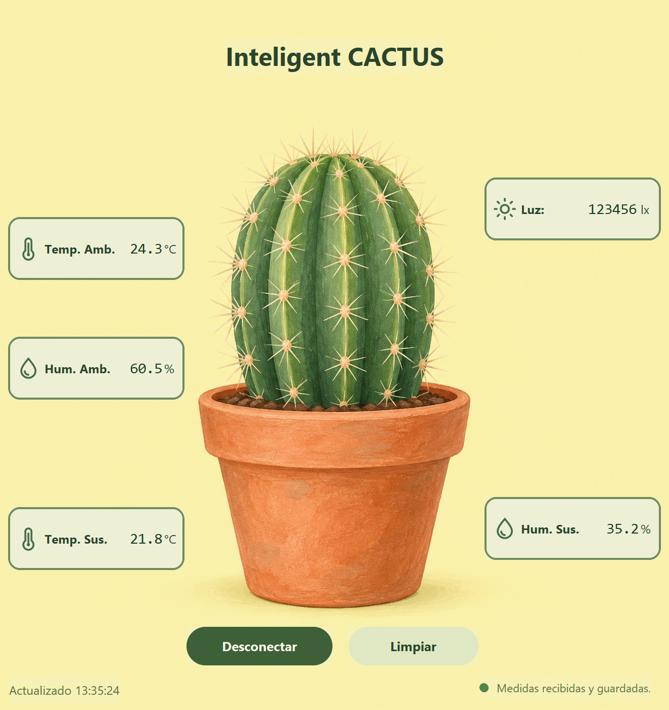
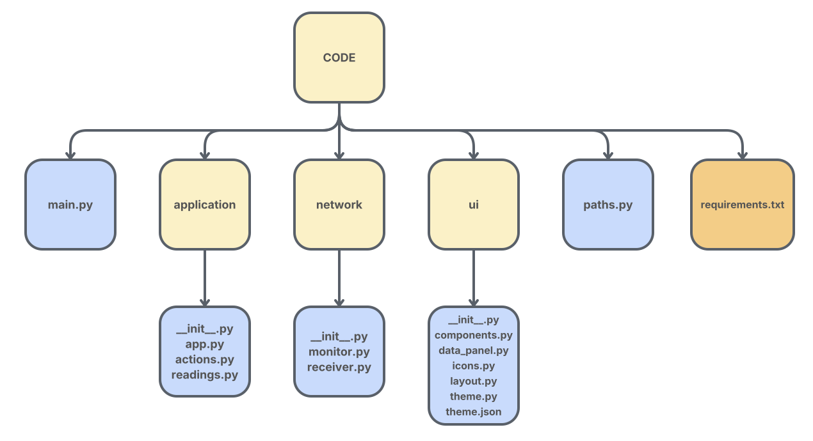
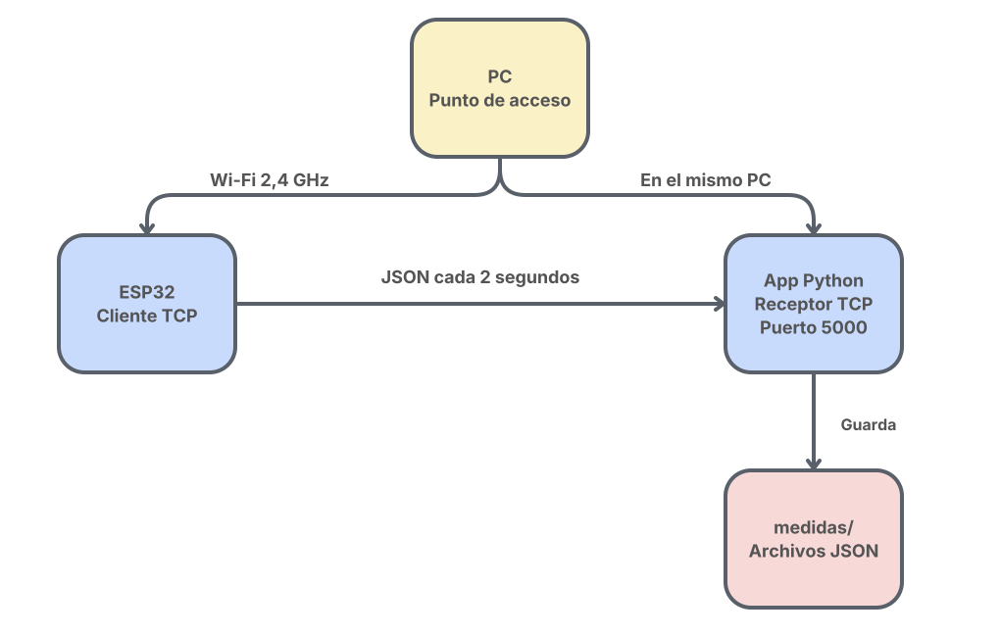

# Inteligent Cactus

<p align="justify">Aplicación de escritorio para recibir medidas de un ESP32 por Wi-Fi, mostrarlas y guardarlas en JSON. Actualmente los datos son <strong>simulados</strong> y varían ligeramente cada dos segundos.</p>

<p align="center">
  
</p>

## La aplicación

<p align="justify">La interfaz está desarrollada en <strong>Python con CustomTkinter</strong>. Muestra temperatura ambiente y del suelo, humedad ambiente y del suelo, iluminación y la hora de la última medida. Algunas de las implementaciones en la aplicación son las siguientes</p>

- **Pulsador conectar ESP32 / Desconectar:** activa o detiene el receptor. Al aceptar la conexión del ESP32, la app lo detecta y actualiza el indicador.
- **Círculo y aviso:** amarillo en espera, verde conectado y rojo desconectado o con error.
- **Limpiar:** vacía la pantalla sin desconectar ni borrar los archivos guardados.
- **Guardado automático:** crea un JSON por medida en `medidas/`, con fecha y hora.

<p align="justify">La recepción funciona en segundo plano para mantener la ventana disponible. La app muestra por terminal las conexiones, los datos recibidos y los archivos guardados.</p>

## Funcionamiento y esquemas

<p align="justify">El PC crea un punto de acceso Wi-Fi y el ESP32 se conecta a esa red. Al pulsar <strong>Conectar ESP32</strong>, el PC empieza a escuchar en el puerto TCP <code>5000</code> mientras el ESP32 inicia la conexión y envía un JSON por línea.</p>

```json
{"ta":24.3,"ts":21.8,"ha":60.5,"hs":35.2,"luz":123456}
```

<p align="justify"><code>ta</code> y <code>ts</code> son temperaturas (°C); <code>ha</code> y <code>hs</code>, humedades (%); <code>luz</code>, iluminación simulada (lx).</p>

### Arquitectura de la app

<picture>
  <source media="(prefers-color-scheme: dark)" srcset="assets/diagramas/estructura-app-claro.svg">
  <source media="(prefers-color-scheme: light)" srcset="assets/diagramas/estructura-app-oscuro.svg">
  
</picture>

<p align="justify"><code>application/</code> organiza la lógica y las lecturas; <code>network/</code> recibe y guarda los datos; <code>ui/</code> contiene la pantalla y sus estilos. La documentación técnica está en <code>docs/</code>.</p>

### Conexión Wi-Fi

<picture>
  <source media="(prefers-color-scheme: dark)" srcset="assets/diagramas/conexion-wifi-claro.svg">
  <source media="(prefers-color-scheme: light)" srcset="assets/diagramas/conexion-wifi-oscuro.svg">
  
</picture>

<p align="justify">El ESP32 es el cliente y la app del PC es el servidor TCP. El botón <strong>Conectar ESP32</strong> activa la escucha del receptor; el ESP32 inicia la conexión y envía las medidas.</p>

## Software necesario

- **Python 3.11**, versión utilizada en el proyecto.
- **CustomTkinter y Pillow**, dependencias de la interfaz recogidas en `CODE/requirements.txt`.
- **PlatformIO con framework Arduino y ArduinoJson 7**, para compilar y cargar el programa del ESP32.

## Hardware utilizado

- **ESP32 WROOM**, compatible con la placa configurada en `platformio.ini`.
- **Adaptador Wi-Fi del PC con punto de acceso en 2,4 GHz**, compatible con el ESP32.

<p align="justify">La versión actual permite probar todo sin sensores físicos. Para medir valores reales hay que conectar los sensores y sustituir los valores simulados de <code>generarMedida()</code>.</p>

## Un poco de código

<p align="justify">En el ESP32, <code>initWifi()</code> conecta a la red, <code>generarMedida()</code> crea los datos y <code>enviarMedida()</code> los transmite. En Python, <code>network/monitor.py</code> entrega las lecturas a <code>submit_readings()</code> para actualizar la pantalla.</p>

<details>
<summary>Ver Python: interpretar y guardar una medida</summary>

Fragmento de `CODE/network/receiver.py`, ejecutado por cada línea recibida:

```python
# Convertir el JSON recibido en un diccionario de Python.
datos = json.loads(linea)

# Crear un nombre distinto para cada medida.
nombre = datetime.now().strftime("%Y-%m-%d_%H-%M-%S_%f.json")
archivo = carpeta / nombre

# Guardar los datos en un archivo JSON legible.
with archivo.open("x", encoding="utf-8") as fichero:
    json.dump(datos, fichero, indent=4, ensure_ascii=False)
```

<p align="justify"><code>json.loads()</code> interpreta el mensaje y <code>json.dump()</code> escribe sus datos en el archivo. La carpeta <code>medidas/</code> se crea automáticamente en la raíz del proyecto o junto al ejecutable.</p>

</details>
